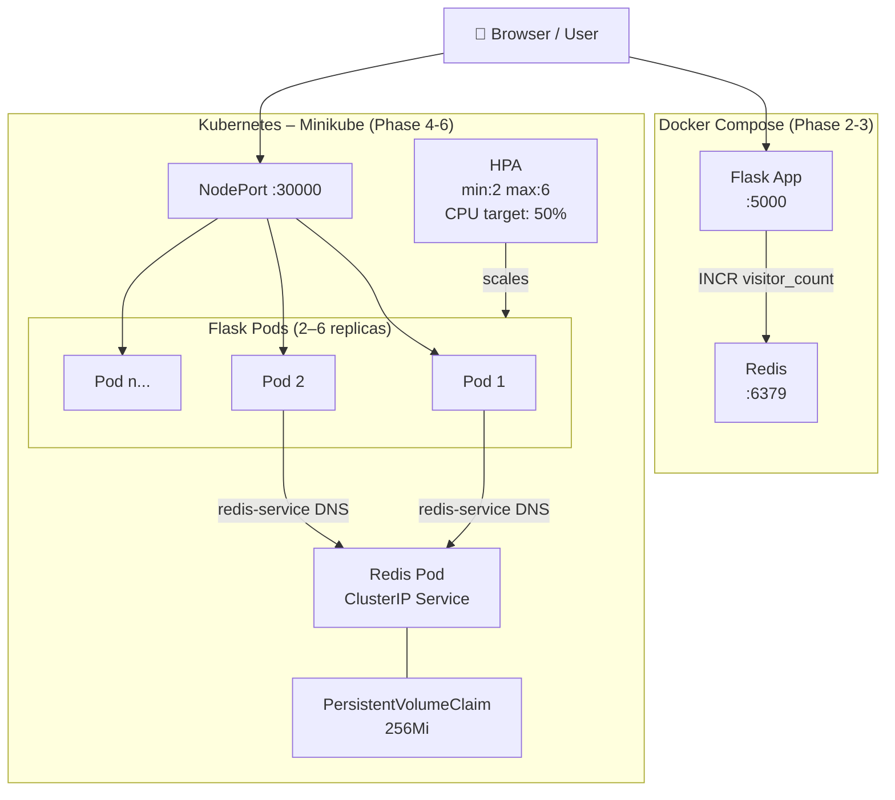

# Cloud Computing Project – Visitor Counter

> **College Cloud Computing Project** | Python Flask + Redis + Docker + Kubernetes + HPA

---

## 📋 Table of Contents
1. [Project Overview](#project-overview)
2. [Architecture](#architecture)
3. [Technology Stack](#technology-stack)
4. [Prerequisites](#prerequisites)
5. [Quick Start (Docker Compose)](#quick-start)
6. [Kubernetes Deployment](#kubernetes-deployment)
7. [Horizontal Pod Autoscaling](#horizontal-pod-autoscaling)
8. [Hybrid Cloud Simulation](#hybrid-cloud-simulation)
9. [Cost Optimization](#cost-optimization)
10. [API Endpoints](#api-endpoints)
11. [Troubleshooting](#troubleshooting)
12. [Project Structure](#project-structure)
13. [Screenshots Checklist](#screenshots-checklist)

---

## Project Overview

This project demonstrates core Cloud Computing concepts through a **Visitor Counter Web Application** that counts and displays how many times the website has been visited.

**What it demonstrates:**
- ✅ Containerization with Docker
- ✅ Container orchestration with Kubernetes (Minikube)
- ✅ Automatic scaling with Horizontal Pod Autoscaler (HPA)
- ✅ Hybrid-cloud simulation with failover
- ✅ Cost optimization techniques

---

## Architecture



---

## Technology Stack

| Component | Technology | Version |
|-----------|-----------|---------|
| Web Framework | Python Flask | 3.0.3 |
| Data Store | Redis | 7.2 Alpine |
| WSGI Server | Gunicorn | 22.0.0 |
| Containerization | Docker | 29+ |
| Orchestration | Kubernetes (Minikube) | 1.37+ |
| Autoscaling | HPA (autoscaling/v2) | — |

---

## Prerequisites

Ensure the following are installed on your Windows machine:

| Tool | Check Command | Required |
|------|--------------|---------|
| Docker Desktop | `docker --version` | ✅ Yes |
| Docker Compose | `docker-compose --version` | ✅ Yes |
| kubectl | `kubectl version --client` | ✅ Yes |
| Minikube | `minikube version` | ✅ Yes |
| Python 3.11+ | `python --version` | ✅ Yes |
| Git | `git --version` | ⚠️ Install needed |

> **Note:** `docker-compose` (v1) is separate from `docker compose` (v2 plugin). This project uses `docker-compose` v1 syntax.

---

## Quick Start

### Run with Docker Compose

```powershell
# 1. Navigate to project root
cd d:\Cloud_Computing_Project

# 2. Build and start all containers
docker-compose up --build

# 3. Open in browser
start http://localhost:5000
```

**To stop:**
```powershell
docker-compose down
```

**To stop and remove data volumes:**
```powershell
docker-compose down -v
```

---

## Kubernetes Deployment

### Phase 4 – Single Cluster (default Minikube)

```powershell
# 1. Start Minikube
minikube start --driver=docker --cpus=2 --memory=2200mb

# 2. Enable Metrics Server (required for HPA)
minikube addons enable metrics-server

# 3. Build Docker image and load into Minikube
docker build -t visitor-counter:latest .
minikube image load visitor-counter:latest

# 4. Deploy Redis
kubectl apply -f k8s/redis-deployment.yaml

# 5. Deploy Flask
kubectl apply -f k8s/flask-deployment.yaml

# 6. Deploy HPA
kubectl apply -f k8s/hpa.yaml

# 7. Check status
kubectl get pods
kubectl get services
kubectl get hpa

# 8. Get application URL
minikube service flask-service --url
```

### Self-Healing Demo

```powershell
# Delete one pod – Kubernetes will recreate it automatically
kubectl delete pod <pod-name>

# Watch Kubernetes replace it
kubectl get pods -w
```

---

## Horizontal Pod Autoscaling

```powershell
# Check HPA status
kubectl get hpa flask-hpa

# Run load test (PowerShell)
.\scripts\load-test.ps1 -Url "http://$(minikube ip):30000" -DurationSec 120

# Watch scaling in real time
kubectl get hpa flask-hpa -w
kubectl get pods -l app=flask-visitor-counter -w
```

**HPA Configuration:**
- Min replicas: **2**
- Max replicas: **6**
- CPU target: **50%** of requested CPU (100m)

---

## Hybrid Cloud Simulation

> ⚠️ **This is a local simulation only.** Both "clouds" run on your machine using Minikube. Redis data is NOT synchronised between clusters.

```powershell
# Set up private-cloud cluster
.\scripts\setup-minikube.ps1 -Cluster "private-cloud"

# Set up public-cloud cluster (run AFTER private-cloud is ready)
.\scripts\setup-minikube.ps1 -Cluster "public-cloud"

# Run failover demo
.\scripts\failover-demo.ps1
```

---

## Cost Optimization

| Technique | Before | After | Saving |
|-----------|--------|-------|--------|
| Docker image (multi-stage build) | ~180 MB (python:3.11) | ~65 MB (slim+deps) | ~64% |
| CPU request (Flask pod) | 500m | 100m | 80% |
| Memory request (Flask pod) | 256Mi | 64Mi | 75% |
| HPA scale-down | 6 replicas idle | 2 replicas idle | 66% compute |

> **Disclaimer:** These are estimated resource savings based on configuration changes. They do not represent actual cloud billing costs.

---

## API Endpoints

| Endpoint | Method | Description |
|----------|--------|-------------|
| `/` | GET | Main page – increments counter |
| `/health` | GET | Liveness probe (always 200) |
| `/ready` | GET | Readiness probe (200 if Redis OK) |
| `/stats` | GET | JSON: current visitor count |
| `/reset` | POST | Reset counter to 0 |

---

## Troubleshooting

### Docker Compose

| Problem | Solution |
|---------|----------|
| Port 5000 in use | Change host port in `docker-compose.yml` to `5001:5000` |
| Redis connection refused | Ensure the `redis` service started first; check `docker-compose logs redis` |
| `docker-compose` not found | Install Docker Compose v1 or use `docker compose` (v2) |

### Kubernetes

| Problem | Solution |
|---------|----------|
| Pods in `ImagePullBackOff` | Run `minikube image load visitor-counter:latest` |
| HPA shows `<unknown>` CPU | Ensure `minikube addons enable metrics-server` was run |
| Cannot access NodePort | Use `minikube service flask-service --url` for the correct URL |
| `minikube start` fails | Check Docker Desktop is running; ensure Hyper-V or WSL2 is enabled |

---

## Project Structure

```
Cloud_Computing_Project/
├── app/
│   ├── app.py                  # Flask application
│   ├── requirements.txt        # Python dependencies
│   ├── templates/
│   │   └── index.html          # HTML UI
│   └── static/                 # CSS/JS assets (future use)
├── k8s/
│   ├── flask-deployment.yaml   # Flask Deployment + Service
│   ├── redis-deployment.yaml   # Redis Deployment + Service + PVC
│   ├── hpa.yaml                # Horizontal Pod Autoscaler
│   ├── private-cloud/          # Manifests for private-cloud cluster
│   └── public-cloud/           # Manifests for public-cloud cluster
├── scripts/
│   ├── load-test.ps1           # HPA load testing script
│   ├── failover-demo.ps1       # Hybrid cloud failover demo
│   ├── setup-minikube.ps1      # Cluster setup helper
│   └── deploy-k8s.ps1          # Kubernetes deploy helper
├── docs/                       # Additional documentation
├── screenshots/                # Project screenshots (not committed)
├── Dockerfile                  # Multi-stage Docker build
├── docker-compose.yml          # Local development stack
├── .dockerignore
├── .gitignore
├── .env.example                # Environment variable template
└── README.md
```

---

## Screenshots Checklist

Take these screenshots during each phase for your submission:

- [ ] **Phase 2:** Flask running locally at `localhost:5000`
- [ ] **Phase 3:** `docker-compose up` output; app at `localhost:5000`
- [ ] **Phase 4:** `kubectl get pods` showing 2 Flask pods Running
- [ ] **Phase 4:** Self-healing – pod deleted and recreated
- [ ] **Phase 5:** `kubectl get hpa` before load test
- [ ] **Phase 5:** `kubectl get hpa` during load test (scaled up)
- [ ] **Phase 5:** `kubectl get hpa` after load test (scaled down)
- [ ] **Phase 6:** Both cluster URLs working in browser
- [ ] **Phase 6:** private-cloud stopped; public-cloud serving traffic
- [ ] **Phase 7:** Docker image sizes before/after optimization

---

## GitHub Setup

```powershell
# Initialize Git (after installing Git)
git init
git add .
git commit -m "Initial commit: Cloud Computing Visitor Counter Project"

# Create repository on github.com, then:
git remote add origin https://github.com/YOUR_USERNAME/cloud-visitor-counter.git
git branch -M main
git push -u origin main
```

---

*Cloud Computing Project | Visitor Counter v1.0*
